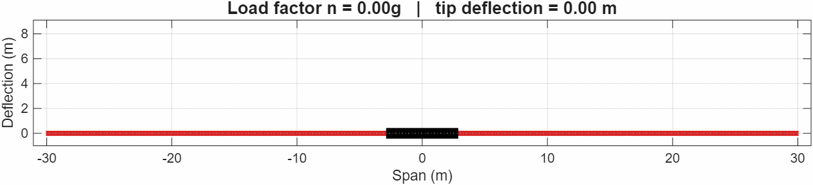
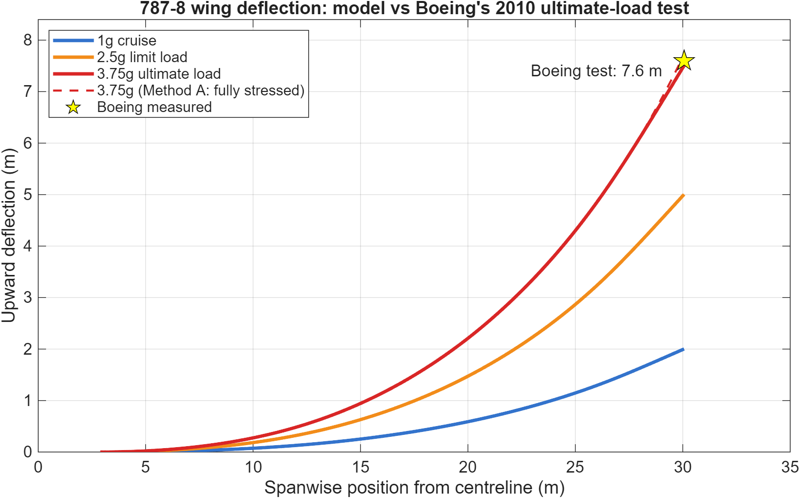
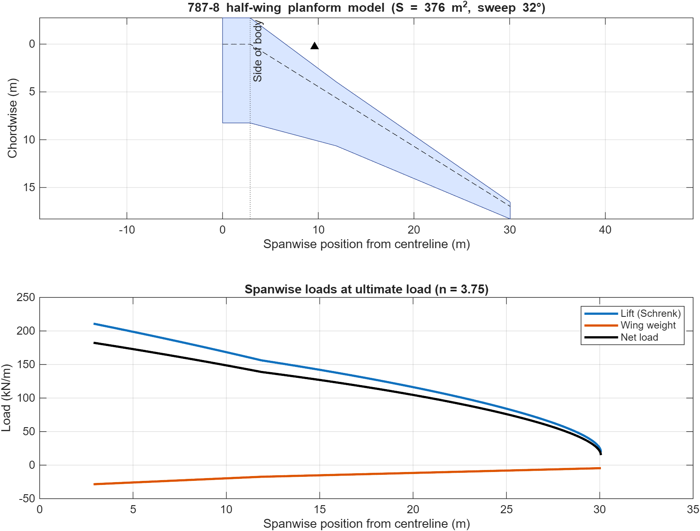
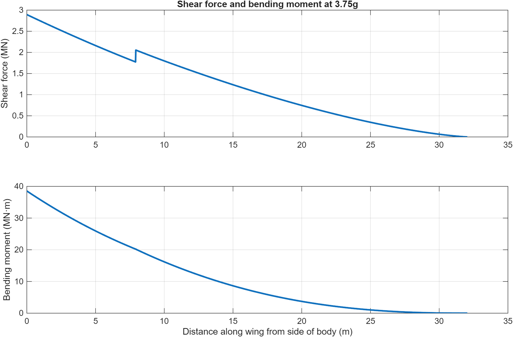
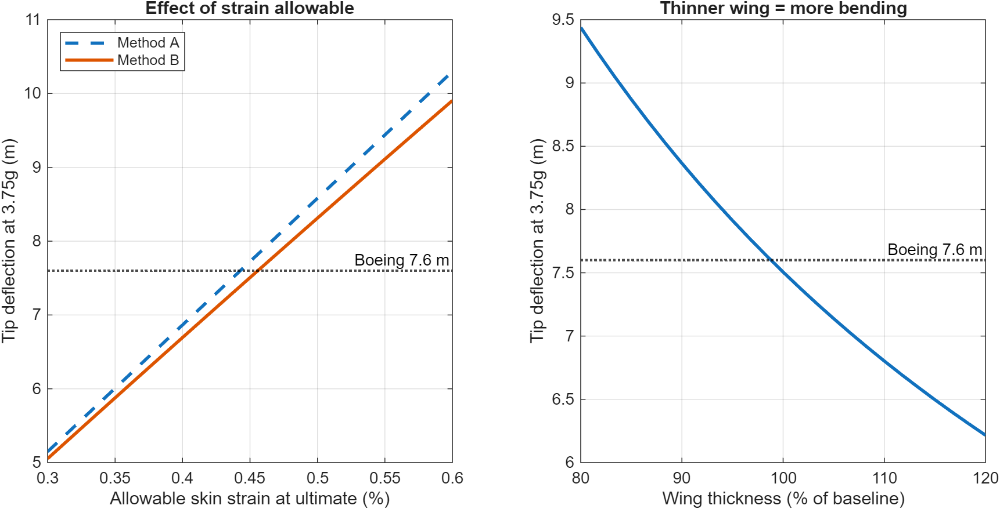
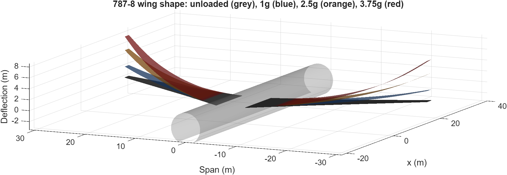

# How much does a Boeing 787 wing bend?

In March 2010, Boeing bent a 787 wing upwards by about **7.6 metres** on purpose. In the ultimate-load test, the wings had to hold 150% of the worst load the aircraft should ever see in service for 3 seconds without breaking.

I wanted to know if I could predict that number myself with a fairly simple model. This is my attempt, written in MATLAB.

## What I found

| Load case | What it means | Tip deflection (my model) |
|---|---|---|
| 1g | Normal cruise | about 2.0 m |
| 2.5g | Limit load: the most the aircraft should ever see | about 5.0 m |
| **3.75g** | **Ultimate load: what Boeing tested** | **about 7.5 m** |
| | **Boeing's measured value** | **7.6 m** |

My model came within about 1–2% of Boeing's test result. I don't want to oversell that, though. The answer depends heavily on one assumption, how far the carbon-fibre skin is allowed to stretch, and changing it within a realistic range moves the result anywhere from about 6 m to 9 m (see the sensitivity plot below). What it does show is that a simple beam model can land in the right range, and that the bend mainly comes from how thin and long the wing is.

## How it works

I modelled each wing as a beam fixed at the side of the fuselage.

**1. Wing geometry**
I took the span (60.12 m), sweep (32°), aspect ratio (9.6) and fuselage width from Wikipedia. The chord shape and thickness are my own estimates, chosen so the wing area comes out at about 376 m², which matches the span and aspect ratio. The wing gets thinner towards the tip (from 15% to 9% thickness-to-chord).

**2. Loads**
- Lift along the span uses **Schrenk's approximation**, the average of an elliptical distribution and one shaped like the wing.
- The wing's own weight and the engine (about 7.7 t installed, placed about 9.6 m from the centreline) push down and reduce the bending a bit.
- Everything is scaled by the load factor, n = 1, 2.5 or 3.75.

**3. Shear force and bending moment**
I integrated the loads from the tip to the root. The root bending moment at ultimate load comes out at about **39 MN·m**. You can see a jump in the shear force where the engine is.

**4. Stiffness**
Boeing doesn't publish skin thicknesses, so I tried two approaches:

- **Method A (fully stressed):** assume the wing is designed so the skin reaches its maximum allowed strain (0.45%) everywhere at ultimate load. The curvature is then just 2ε/h, so the bend depends only on the strain limit and the wing depth. You don't even need the material stiffness.
- **Method B (sized wing box):** model the wing box as a thin-walled rectangle (E = 70 GPa) and size the skin thickness to hit the strain limit, with a minimum thickness of 4 mm towards the tip.

Both methods give similar answers: 7.7 m and 7.5 m.

**5. Deflection**
Integrate the curvature twice, starting from zero slope and zero deflection at the root.

## How sensitive is it?

This was the most interesting part for me. The bend is very sensitive to the strain limit and to how thick the wing is. A 20% thinner wing bends about 2 m more.

## Limitations

There's a lot this model doesn't capture:
- It's linear beam theory, with no twisting, no bend–twist coupling from the sweep, and no large-deflection effects.
- The chord, thickness, wing mass and strain limit are my own estimates, not Boeing data.
- There's no aeroelasticity. In reality, bending the wing changes the lift distribution.
- I ignored fuel in the wings, which would reduce the bending.
- The wing box is treated as a simple rectangle, with stringers and spars smeared into one equivalent skin thickness.

## Running it

1. Open `wing_bending_787.m` in MATLAB (R2022a or newer, no toolboxes needed).
2. Press Run. Don't click on any figure windows while it's running, especially during the GIF.
3. Every assumption is in the **USER SETTINGS** block at the top, so you can change the strain limit, thickness, masses and so on, and see what happens.

## References

- "Boeing 787 Dreamliner", Wikipedia (accessed November 2026): span, sweep, aspect ratio, MTOW, fuselage width, and the ultimate-load test description.
- Boeing press release, "Boeing Confirms Success on 787 Wing, Fuselage Ultimate Load Test", 7 April 2010.
- Schrenk, O. (1940). A simple approximation method for obtaining the spanwise lift distribution. NACA TM 948.
- CS-25 / FAR Part 25 §25.303 and §25.305: factor of safety (1.5) and the strength and deformation requirements.

---
*A personal project by Yara, 2nd year MEng Aerospace Engineering. Feedback is very welcome!*
